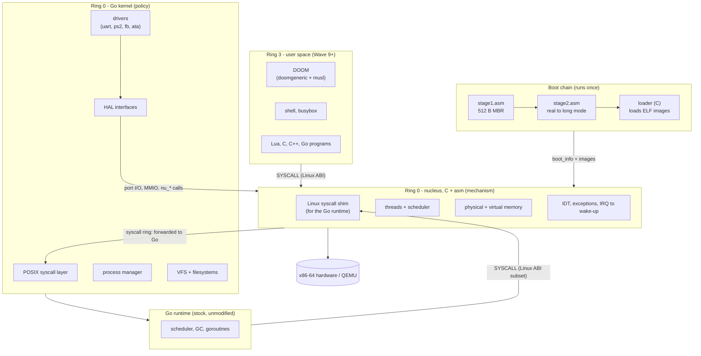
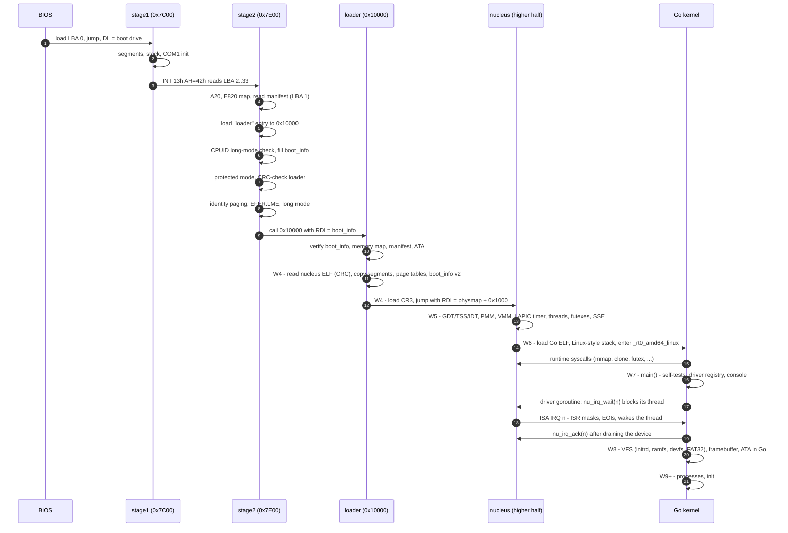
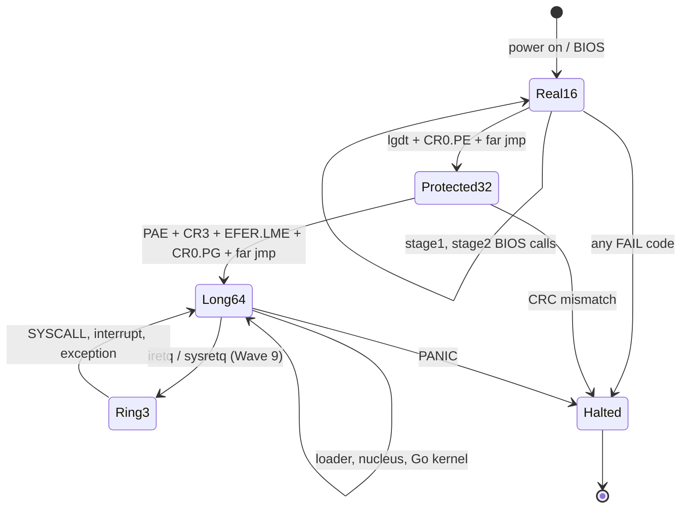
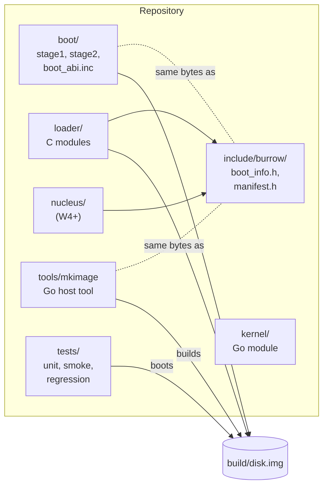
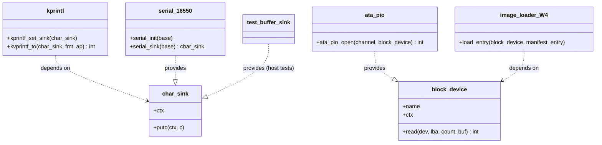
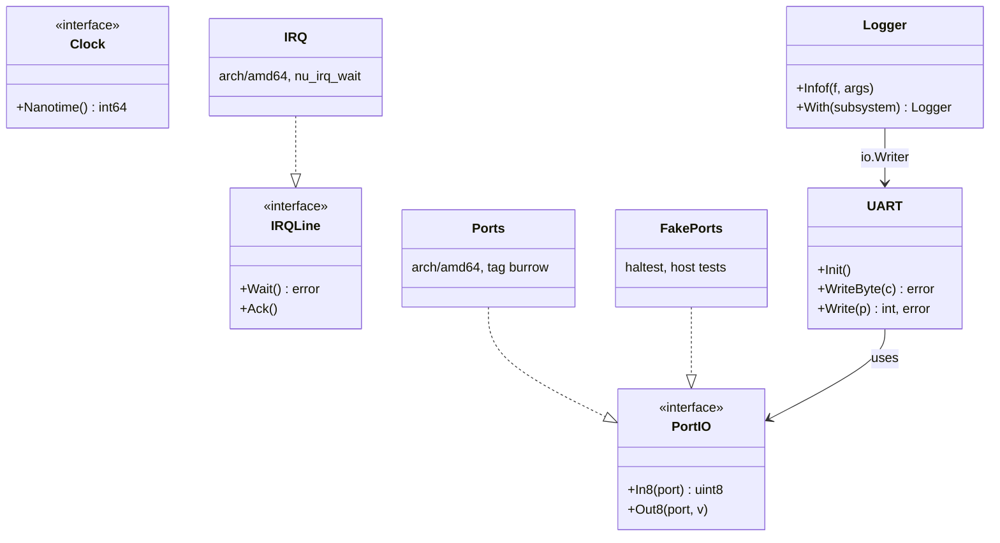
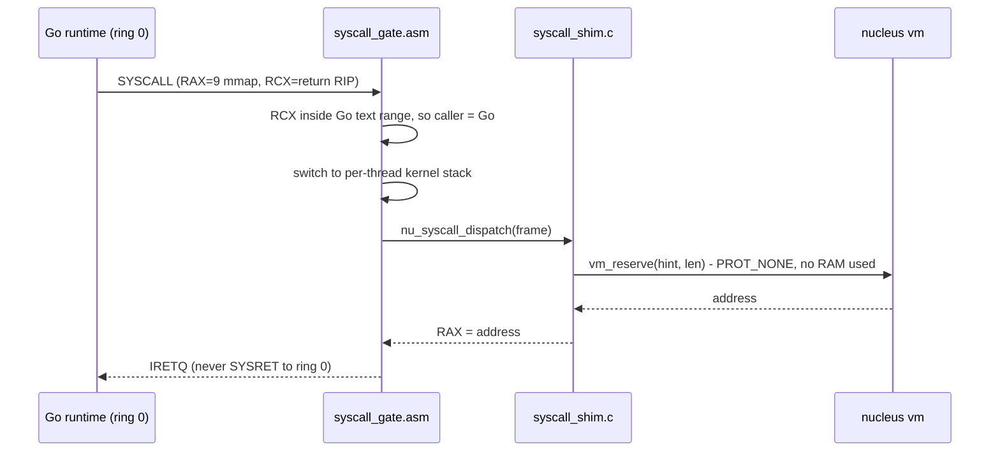
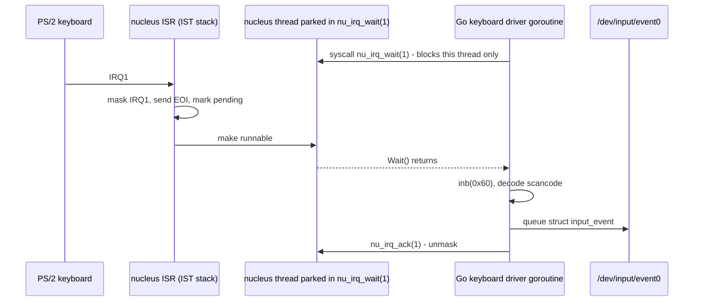
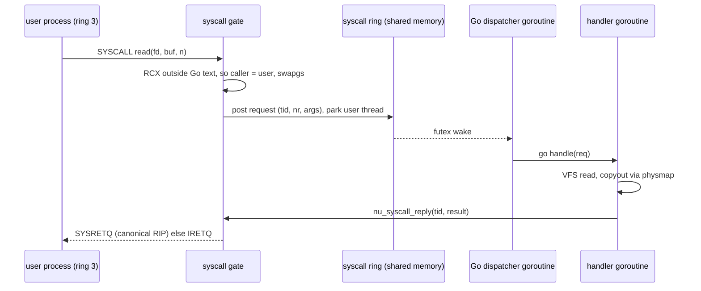
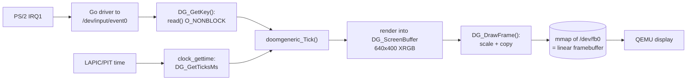

# Burrow Architecture

> Status: **living document**. Sections marked *(provisional)* are validated by a spike slice before they are relied on. Last reviewed: Wave 3 complete.

This is the map of the whole system. Read it once end-to-end, then come back to the section that matches the wave you are working on.

## 1. The one-paragraph version

Burrow boots through **four layers, each written in the language that suits it best**. Assembly does what only assembly can (the first 512 bytes, CPU mode switches). C does the careful, byte-exact work of loading images and owning the hardware *mechanisms* (page tables, interrupts, context switches). Go runs on top as the actual kernel, owning *policy* (processes, files, drivers, POSIX). The trick that makes Go possible is that the C layer (the **nucleus**) pretends to be a tiny Linux: the stock Go compiler builds the kernel as an ordinary `linux/amd64` program, and every system call the Go runtime makes is answered by the nucleus. Later, user programs built against musl libc speak the very same Linux system-call ABI, so Doom, Lua and friends port with minimal changes.

## 2. Layers

| Layer | Language | Owns | Never does |
|---|---|---|---|
| stage1 | NASM, 16-bit | load stage2 | anything else (512-byte budget) |
| stage2 | NASM, 16/32/64-bit | A20, memory map, mode switches, verify + start loader | parse ELF, drive hardware beyond BIOS |
| loader | freestanding C | read disk, verify images, load ELF, build first real page tables, fill `boot_info` | stay resident after hand-off |
| nucleus | C + asm | IDT/GDT/TSS, PMM/VMM mechanism, threads, futexes, timers, syscall gate, Linux shim for the Go runtime | file systems, process policy, POSIX semantics |
| Go kernel | Go (+ tiny Go asm) | drivers, VFS, processes, POSIX syscalls, console | interrupt handlers (it receives *wake-ups*, not interrupts) |
| user space | C/C++/Go/Lua + musl | applications | — |

**Why split mechanism (C) from policy (Go)?** Everything that must run with interrupts off, on a fixed stack, without allocating, lives in C. Go's runtime can allocate, grow stacks and pause for GC at almost any function call, which is fine for policy and lethal inside an interrupt handler. This split is the single most important design decision; see [ADR-0003](../03-decisions/ADR-0003-go-runtime-hosting.md).

## 3. Boot sequence

## 4. CPU mode state machine

## 5. Component view (static structure)

The `include/burrow/` headers are **contracts** between components written in different languages. Each contract is mirrored in exactly one other place (`boot/boot_abi.inc` for asm, `tools/mkimage/manifest.go` for Go) and is protected by tests: `_Static_assert` offsets in C, `TestManifestLayoutMatchesC` in Go, and the smoke test end-to-end.

## 6. Interfaces (UML)

### 6.1 C "interfaces" (struct of function pointers)

### 6.2 Go kernel HAL

## 7. Data flows

### 7.1 A Go runtime system call (Wave 6)

### 7.2 An interrupt becomes a goroutine wake-up (Wave 7)

### 7.3 A user system call (Wave 9) *(provisional)*

### 7.4 One DOOM frame (Wave 11)

## 8. Design principles applied (SOLID and friends)

| Principle | Where you will see it |
|---|---|
| **S**ingle responsibility | One file = one job: `crc32.c`, `elf64.c`, `manifest.c`. Stage1 *only* loads stage2. The shim has one function per syscall. |
| **O**pen/closed | New syscall = new table row. New disk controller = new `block_device` provider. New boot stage = new smoke markers appended, old ones never edited. |
| **L**iskov substitution | Every fake (`FakePorts`, buffer `char_sink`) must be usable wherever the real one is. Conformance tests per interface arrive with the second implementation (W8: ramdisk vs ATA). |
| **I**nterface segregation | `PortIO` has 2 methods, `IRQLine` 2, `char_sink` 1. Drivers ask for the smallest interface they need. |
| **D**ependency inversion | `kprintf` depends on `char_sink`, not the UART. Go drivers depend on `hal`, implementations are injected in `main`. This is *why* most kernel code runs as plain host unit tests. |
| Pure core, thin shell | Parsing/validation (ELF, manifest, CRC, printf, memory map) is pure and host-tested; hardware access is pushed to thin edges (`io.h`, `arch/amd64`). |
| Verify before execute | stage2 CRC-checks the loader before jumping; the loader will CRC-check the nucleus and kernel ([BUG-0003](../living/BUGS_AND_MITIGATIONS.md)). |
| Contracts are tested | Every cross-language struct has offset assertions on both sides. |

## 9. Where to go next

The physical and virtual memory layouts are in [MEMORY_MAP.md](MEMORY_MAP.md). Boot data structures, error codes and markers are in [BOOT_PROTOCOL.md](BOOT_PROTOCOL.md). The Go/nucleus contract is in [GO_RUNTIME_HOSTING.md](GO_RUNTIME_HOSTING.md), and the private nucleus calls in [NUCLEUS_ABI.md](NUCLEUS_ABI.md).
