# Burrow Architecture

> Status: **living document**. Sections marked *(provisional)* are validated by a spike slice before they are relied on. Last reviewed: Wave 3 complete.

This is the map of the whole system. Read it once end-to-end, then come back to the section that matches the wave you are working on.

## 1. The one-paragraph version

Burrow boots through **four layers, each written in the language that suits it best**. Assembly does what only assembly can (the first 512 bytes, CPU mode switches). C does the careful, byte-exact work of loading images and owning the hardware *mechanisms* (page tables, interrupts, context switches). Go runs on top as the actual kernel, owning *policy* (processes, files, drivers, POSIX). The trick that makes Go possible is that the C layer (the **nucleus**) pretends to be a tiny Linux: the stock Go compiler builds the kernel as an ordinary `linux/amd64` program, and every system call the Go runtime makes is answered by the nucleus. Later, user programs built against musl libc speak the very same Linux system-call ABI, so Doom, Lua and friends port with minimal changes.

## 2. Layers

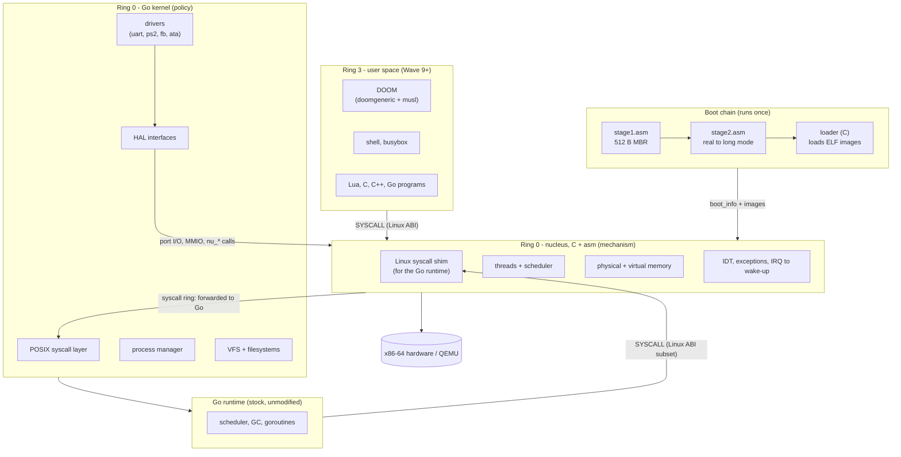

| Layer | Language | Owns | Never does |
|---|---|---|---|
| stage1 | NASM, 16-bit | load stage2 | anything else (512-byte budget) |
| stage2 | NASM, 16/32/64-bit | A20, memory map, mode switches, verify + start loader | parse ELF, drive hardware beyond BIOS |
| loader | freestanding C | read disk, verify images, load ELF, build first real page tables, fill `boot_info` | stay resident after hand-off |
| nucleus | C + asm | IDT/GDT/TSS, PMM/VMM mechanism, threads, futexes, timers, syscall gate, Linux shim for the Go runtime | file systems, process policy, POSIX semantics |
| Go kernel | Go (+ tiny Go asm) | drivers, VFS, processes, POSIX syscalls, console | interrupt handlers (it receives *wake-ups*, not interrupts) |
| user space | C/C++/Go/Lua + musl | applications | — |

**Why split mechanism (C) from policy (Go)?** Everything that must run with interrupts off, on a fixed stack, without allocating, lives in C. Go's runtime can allocate, grow stacks and pause for GC at almost any function call, which is fine for policy and lethal inside an interrupt handler. This split is the single most important design decision; see [ADR-0003](../03-decisions/ADR-0003-go-runtime-hosting.md).

## 3. Boot sequence

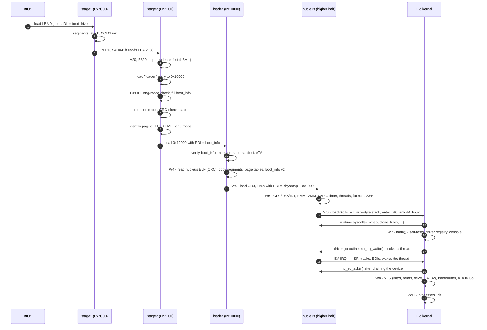

## 4. CPU mode state machine

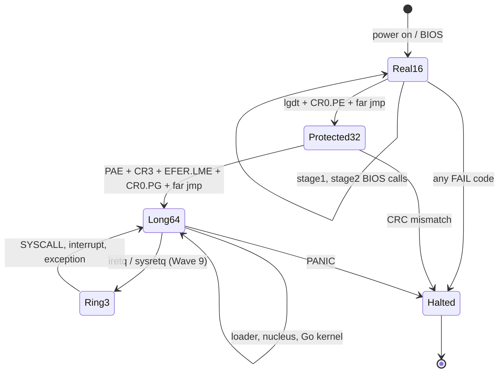

## 5. Component view (static structure)

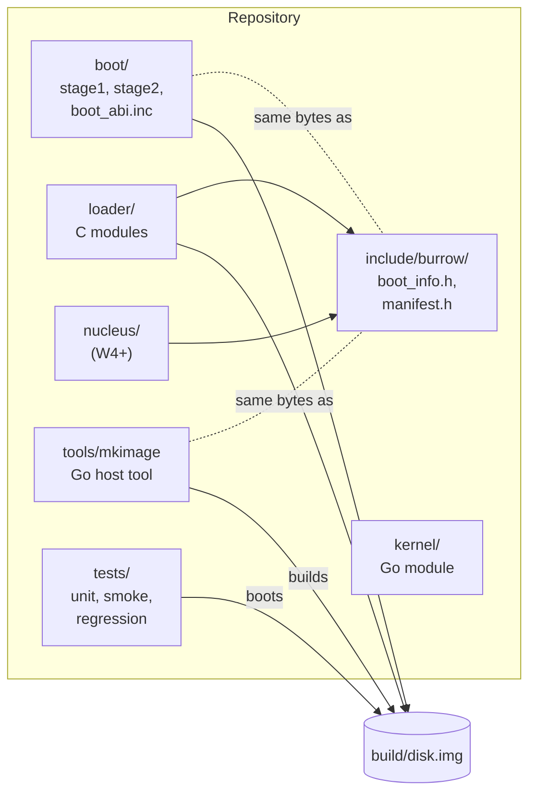

The `include/burrow/` headers are **contracts** between components written in different languages. Each contract is mirrored in exactly one other place (`boot/boot_abi.inc` for asm, `tools/mkimage/manifest.go` for Go) and is protected by tests: `_Static_assert` offsets in C, `TestManifestLayoutMatchesC` in Go, and the smoke test end-to-end.

## 6. Interfaces (UML)

### 6.1 C "interfaces" (struct of function pointers)

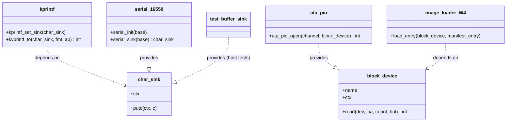

### 6.2 Go kernel HAL

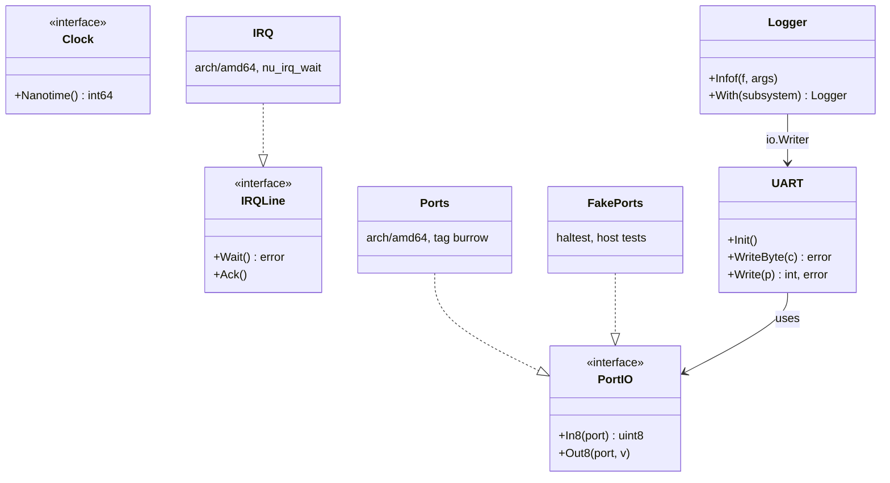

## 7. Data flows

### 7.1 A Go runtime system call (Wave 6)

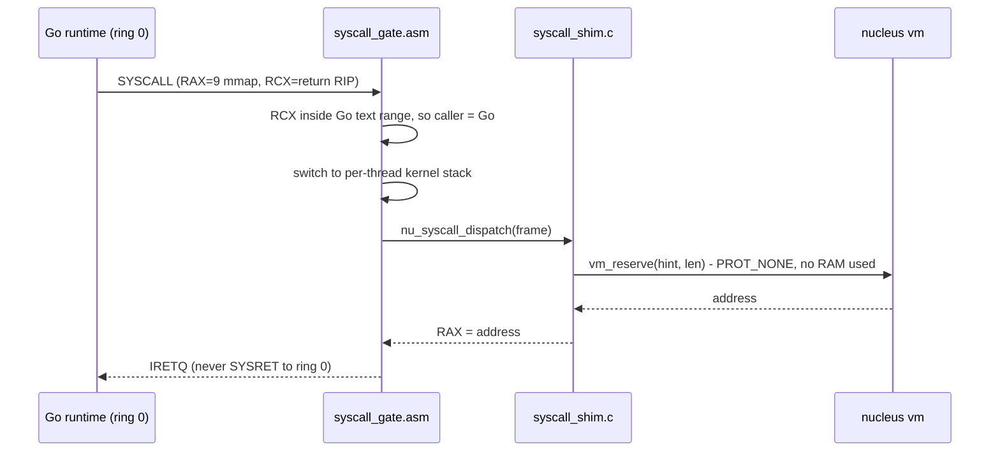

### 7.2 An interrupt becomes a goroutine wake-up (Wave 7)

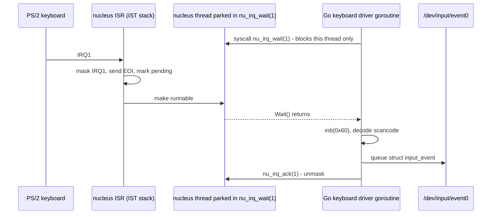

### 7.3 A user system call (Wave 9, full frames since Wave 10)

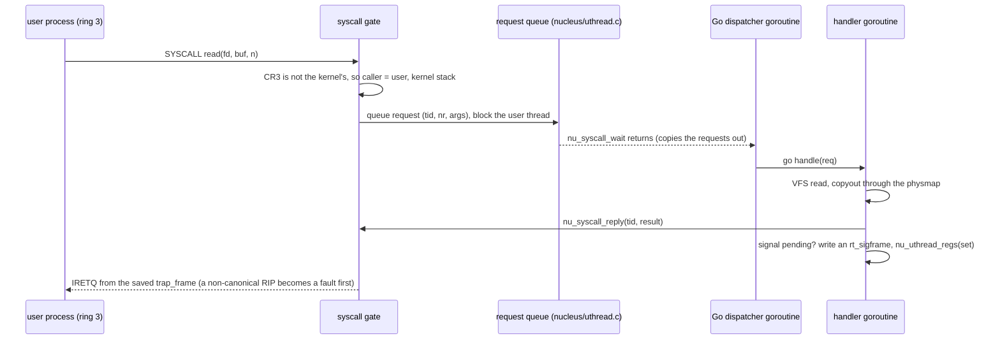

### 7.4 One DOOM frame (Wave 11)

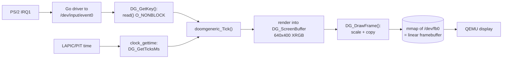

### 7.5 Many CPUs (Wave 20)

Every CPU the ACPI MADT lists comes online at boot (ADR-0011). The nucleus
copies a trampoline (`nucleus/ap.asm`) to physical 0x8000 and starts each
application processor with INIT and two STARTUP IPIs; the AP climbs from
real mode to long mode, loads its own GDT, TSS and IST stacks, binds
`GS_BASE` to its `struct percpu`, turns on its LAPIC timer and becomes its
own idle thread. From then on, all CPUs schedule from one run queue:

- **Per-CPU state through GS.** `this_cpu()` is one `gs:` load; `trap.asm`
  and `syscall.asm` read the current kernel stack at `gs:0`/`gs:8`. Ring 3
  runs with the user's GS base: every entry from ring 3 and every return to
  it swaps (`swapgs`), and SYSCALL has a user and a kernel entry, which the
  scheduler switches between in LSTAR.
- **One run queue.** `g_sched_lock` guards every thread's state and is held
  across the context switch; the thread switched to releases it. Waking a
  thread sends the wake IPI (0xF0) to an idle CPU that may run it. Lock
  order: an object's lock (futex bucket, IRQ lines, the uthread FIFO), then
  the scheduler's.
- **TLB shootdown.** Each CPU publishes the page-table root it runs on; a
  change to a present entry is flushed on every CPU on that root (all of
  them for the shared upper half) through IPI 0xF1 before the call returns
  and before a freed frame is reused. CPUs spinning on a lock with
  interrupts off answer shootdowns while they spin.
- **Go on every CPU.** The shim's `sched_getaffinity` reports the CPUs
  online, so the Go kernel runs with that many Ps; `kernel/proc` reports
  the same to user programs (`nproc`, `sysconf`, a Go program's
  GOMAXPROCS). Interrupts from devices still arrive on CPU 0 through the
  8259; a driver's goroutine may run anywhere.

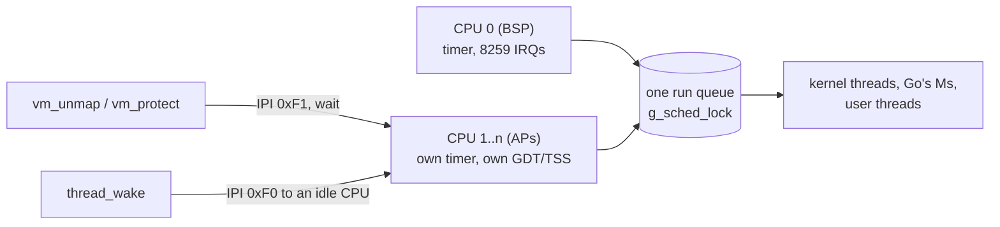

### 7.6 Framebuffer and firmware (Wave 21)

The screen's mode comes from the firmware, as on real hardware, not from
QEMU's Bochs registers. An image asks for a mode with a small `video`
payload (`mkimage -video WxHxB[,pitch]`); stage2's last real-mode step
(`boot/vbe16.inc`) walks the VBE mode list, sets a linear direct-colour
mode, asks for a padded scanline with 4F06 when told to, and records base,
size, pitch, depth and colour fields in boot_info (version 3). The nucleus
checks that descriptor (`nucleus/fbdesc.c`) and clears it if it is wrong;
the Go kernel's display driver maps it write-combining (the PAT's entry 1
is WC on every CPU) and hands `gfx` the geometry and pixel format, and only
an image that asked for nothing (or a mode the BIOS lacks) gets a DISPI mode
instead. `/dev/fb0` reports the mode as it is, `line_length` included, and
maps it into programs write-combining too, so a page never has two memory
types.

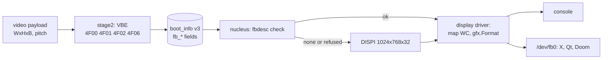

Programs must take the geometry from `FBIOGET_VSCREENINFO` and step rows by
`line_length`; `make fb-smoke` boots 1280x1024 with a 5248-byte pitch to
keep that true.

### 7.7 Sound and input (Wave 22)

Two PCI devices arrived together, and QEMU put both on IRQ 11 beside the
e1000, so the wave started with **shared lines**: the nucleus still lets one
thread wait on a line, and in Go that thread is the line's goroutine
(`driver.Lines`), which calls every handler registered there; each reads its
own device's status and says whether the interrupt was its own (an
unclaimed one is counted and logged once).

**Sound** is an AC'97 (`drivers/ac97`): the mixer and the bus master are two
I/O BARs, and playback is a ring of 32 buffer descriptors pointing at DMA
pages. The driver fills buffers ahead of the card and moves the last valid
index forward after the data is written; an interrupt per completed buffer
frees room. `kernel/sound` puts OSS's playback subset over it as
`/dev/dsp`: rates through the codec's variable rate, 16-bit stereo native and
8-bit or mono converted, `write` blocking while the ring is full, one
opener. Doom mixes its effects in a thread and writes them there.

**The pointer** is QEMU's virtio tablet. `kernel/virtio` is the virtio 1.0
PCI transport, pure Go: the capabilities in configuration space, the status
handshake with `VIRTIO_F_VERSION_1` required, split virtqueues in DMA pages
whose indices are read and written as whole aligned words, notification
and the ISR. `drivers/virtioinput` keeps the event queue full of 8-byte
buffers; the device's events are already Linux input events, and
`kernel/evdev` makes them `/dev/input/event2` (`EV_ABS` with `EVIOCGABS`
ranges). Readers of the relative `/dev/input/mice` (TinyX) get the same
packets as moves: the position scaled to the current mode minus the last
one, a session starting at the screen's centre, and moves to an edge
overshot by a screen so a reader that lost packets clamps back in step.

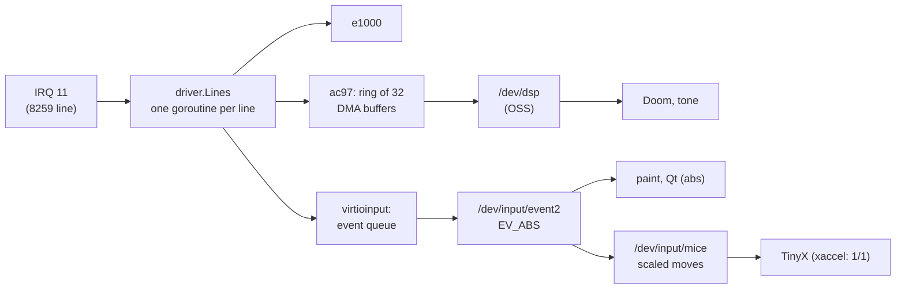

The virtio transport is meant for more than input: virtio-blk and
virtio-net would use the same capabilities, negotiation and queues.

### 7.8 /proc and virtio devices (Wave 23)

**/proc** is `kernel/procfs`, an `io/fs.FS` built over a small `Source`
interface that `proc.System` implements: procfs never imports the process
code. Each open takes one snapshot (under `s.mu`, then each `p.mu`, then
the memory's lock, one at a time) and formats it as `proc(5)` says, so
busybox, musl and Go parse it unchanged. Some links read differently for
each process: `self`, and `fd/N`, `exe` and `cwd`, which only the
process's user or root may read. The VFS carries a `Caller` through its
walk for them (`ResolveAs`, `ReadLinkAs`). A descriptor with a path is
reopened by following its link; a pipe's or socket's `fd/N` gives the
caller the same description.

**CPU time** is the nucleus's to count (`nucleus/cputime.c`): at every
switch, every tick and every crossing between ring 3 and the kernel, the
running thread's time goes to user, kernel or (for a CPU's idle thread)
idle. Only the CPU running a thread writes its counters, and they only
grow, so Go reads them with two nucleus calls and no lock. Go keeps the
time of threads that end, fixes a process's at exit and adds it to the
parent that reaps it (`times`, `getrusage`, `wait4`'s `rusage`,
`/proc/stat`). Time Go spends serving a call is not charged to the caller.

**virtio devices** reuse W22's transport: `drivers/virtiopci` opens a
device, `drivers/virtioblk` makes block devices of chained requests
(header, data pages, status) with several in flight, `drivers/virtionet`
keeps a receive queue full and sends from slots. The disks are mounted by
label like the IDE ones, the card is `eth0` like the e1000.
`virtio/virtiotest` plays the device in host tests. **DHCP** takes its
first lease on raw frames before the stack exists, then renews over the
stack's own UDP.

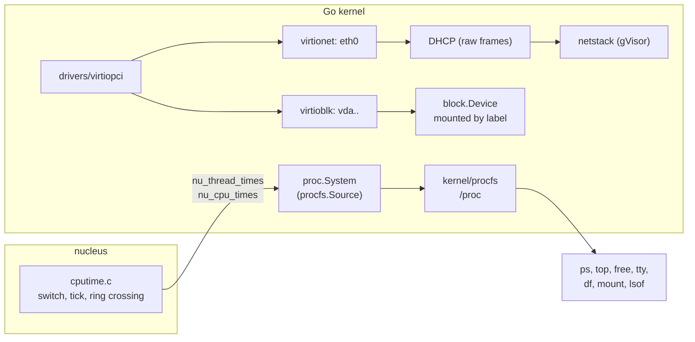

### 7.9 Remote access and the web (Wave 24)

Wave 24 added no kernel layer: it ported programs and fixed what they
found. **TLS** is mbedTLS, a static library on the NETDATA disk
(`/opt/net`) with Mozilla's CA bundle; `curl` and NetSurf use it through
libcurl, busybox `wget` uses its own TLS. **ssh** is dropbear: the server
checks `/etc/shadow` and `authorized_keys`, gives each session a
pseudo-terminal and the user's ids, and runs itself again for each
connection (`execveat`); `dbclient` and `scp` are its client side. The
**browser** is NetSurf's framebuffer front end drawing through libnsfb's
X surface into an X window (MIT-SHM images), fetching with libcurl.

Each port's system calls were taken on the host first (`census-net.sh`,
`census-ssh.sh`, `census-browser.sh`) and checked against `kernel/proc`'s
table (`TestCensus*`). What the ports found: `set_robust_list` and
`execveat` (dropbear), owners for pseudo-terminal slaves (a session's
`chown`), write-back of big files by doublings (`scp`, `wfile`), `mkdir`'s
`EEXIST` before permission (BUG-0031), and directories that only mounts
make, which must be walked (BUG-0030) and read as "not a link" (BUG-0032).

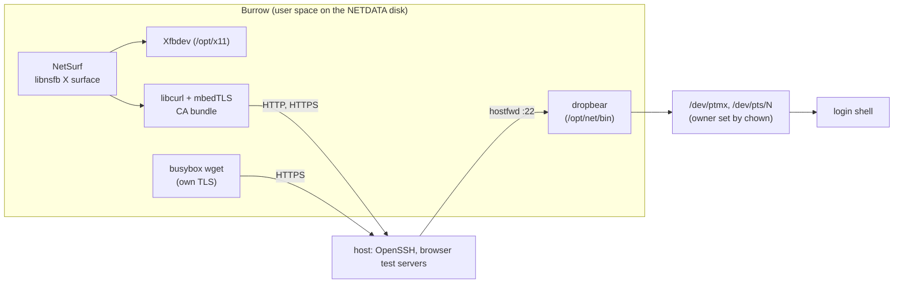

### 7.10 The round trip, measured and shortened (Wave 25)

A user system call is still the request of §7.3; W25 measured it step by
step and shortened what did not need to be there (ADR-0012). The nucleus
stamps one traced request with the TSC at the gate, when Go takes it, when
Go answers, when the thread runs again and on its way out
(`nucleus/lattrace.c`, read through `/dev/lattrace`); `user/lat.c` times
whole round trips on Burrow and on the host's Linux (`make lat-bench`,
`make lat-linux`). Three changes came of it:

- **Clock reads are not calls.** A vDSO (`[vvar]`, a data page the nucleus
  keeps with a sequence count, and `[vdso]`, code from `user/vdso/vdso.c`)
  is mapped into every process and into the Go kernel itself, named by
  `AT_SYSINFO_EHDR`; musl and Go find it on their own.
- **Calls that cannot block are answered on the dispatcher**
  (`kernel/proc/quick.go`), with no goroutine, unless a signal is ready.
- **An answer travels with the next wait** (`nu_syscall_reply_wait`): one
  crossing hands the CPU to the answered thread and blocks the dispatcher.

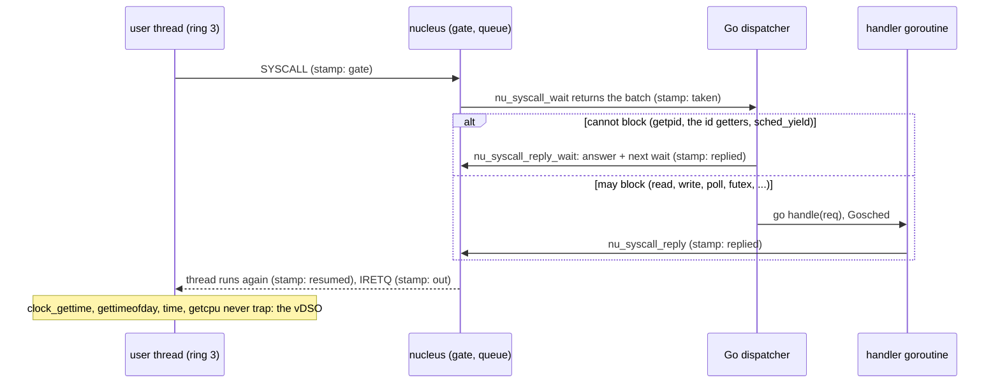

| On QEMU TCG, four CPUs | W24's end (S01) | W25's end |
|---|---|---|
| `getpid` | 101-155 us | 48-94 us |
| getpid's Go side (taken to replied) | 68-70 us | 23-43 us |
| a clock read | 110-164 us | 0.08-0.14 us |
| the Go kernel's own calls per user call | 5.1 | 0.14 |
| pipe / futex / socketpair ping-pong | 351-437 / 116-211 / 379-602 us | 400-524 / 181-213 / 402-581 us |
| loopback TCP ping-pong | 1933-2713 us | 2168-2840 us |
| `scp` 4 MiB | 1.0-1.1 MB/s | 1.15-1.27 MB/s |
| NetSurf's first page | 3.52 s | 2.71-2.82 s |

What is left is a blocking call's hand-off between goroutines (a pipe
write: 118 us from taken to answered), which answering on the dispatcher
does not fix: the goroutines such a call wakes wait for the dispatcher's P
while it waits in the nucleus (W25-S04; RISKS.md R-09).

## 8. Design principles applied (SOLID and friends)

| Principle | Where you will see it |
|---|---|
| **S**ingle responsibility | One file = one job: `crc32.c`, `elf64.c`, `manifest.c`. Stage1 *only* loads stage2. The shim has one function per syscall. |
| **O**pen/closed | New syscall = new table row. New disk controller = new `block_device` provider. New boot stage = new smoke markers appended, old ones never edited. |
| **L**iskov substitution | Every fake (`FakePorts`, buffer `char_sink`) must be usable wherever the real one is. Conformance tests per interface arrive with the second implementation (W8: ramdisk vs ATA). |
| **I**nterface segregation | `PortIO` has 2 methods, `IRQLine` 2, `char_sink` 1. Drivers ask for the smallest interface they need. |
| **D**ependency inversion | `kprintf` depends on `char_sink`, not the UART. Go drivers depend on `hal`, implementations are injected in `main`. This is *why* most kernel code runs as plain host unit tests. |
| Pure core, thin shell | Parsing/validation (ELF, manifest, CRC, printf, memory map) is pure and host-tested; hardware access is pushed to thin edges (`io.h`, `arch/amd64`). |
| Verify before execute | stage2 CRC-checks the loader before jumping; the loader will CRC-check the nucleus and kernel ([BUG-0003](../living/BUGS_AND_MITIGATIONS.md)). |
| Contracts are tested | Every cross-language struct has offset assertions on both sides. |

## 9. Where to go next

The physical and virtual memory layouts are in [MEMORY_MAP.md](MEMORY_MAP.md). Boot data structures, error codes and markers are in [BOOT_PROTOCOL.md](BOOT_PROTOCOL.md). The Go/nucleus contract is in [GO_RUNTIME_HOSTING.md](GO_RUNTIME_HOSTING.md), and the private nucleus calls in [NUCLEUS_ABI.md](NUCLEUS_ABI.md).
