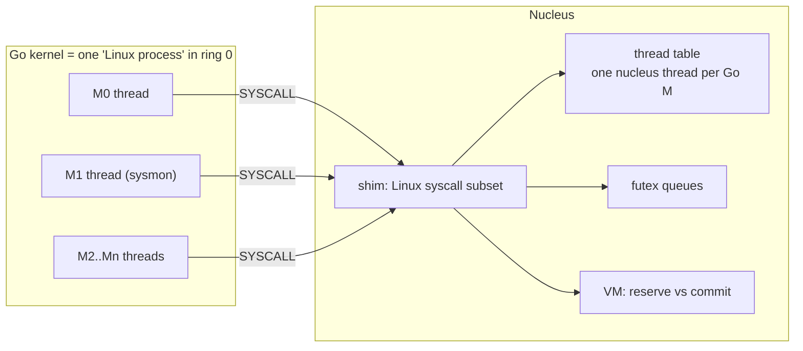

# Hosting the Go Runtime on the Nucleus

The contract between the nucleus (C) and the stock Go runtime. Decision record: [ADR-0003](../03-decisions/ADR-0003-go-runtime-hosting.md). Evidence: [syscall census](../01-research/GO_RUNTIME_SYSCALL_CENSUS.md).

## 1. The model in one picture



The Go runtime thinks it is a normal Linux program. Its OS threads ("M"s) are nucleus threads; its locks are futexes; its heap is anonymous `mmap`. Nothing in the Go toolchain is modified.

## 2. Build contract

```sh
CGO_ENABLED=0 GOOS=linux GOARCH=amd64 \
  go build -tags burrow -trimpath \
  -ldflags='-T 0x7e0000000000 -s' -o build/kernel.elf ./kernel/cmd/kernel
```

`CGO_ENABLED=0` gives a fully static binary that issues raw `SYSCALL` instructions (no libc). Pin the toolchain version in `go.mod` (`toolchain go1.27.x`) once the target build lands.

## 3. Start-up contract

The nucleus, acting like `execve`:

1. Loads every `PT_LOAD` segment of `kernel.elf` (supervisor pages, NX on non-text).
2. Records `[text_lo, text_hi)` for the syscall gate's caller check.
3. Maps a stack (64 KiB, guard page below), builds argc/argv/envp/auxv (`snippets/nucleus/go_initial_stack.c`). Env: `GODEBUG=asyncpreemptoff=1`, `GOTRACEBACK=all`. Auxv: `AT_PAGESZ`, `AT_RANDOM`, `AT_PHDR/PHENT/PHNUM`, `AT_ENTRY`. **No** `AT_SYSINFO_EHDR`, so the runtime uses real `clock_gettime`.
4. Enables SSE (CR0.EM=0, CR0.MP=1, CR4.OSFXSR, CR4.OSXMMEXCPT). Go amd64 *requires* SSE2. Leave CR4.OSXSAVE off initially so the runtime does not use AVX state the nucleus does not save; enable XSAVE in a later slice.
5. Creates thread 1 with `FS_BASE=0`, interrupts on, jumps to `e_entry` via `iretq` into ring 0.

## 4. Runtime syscall contract (initial)

| Syscall | Nucleus behaviour | Why it matters |
|---|---|---|
| `arch_prctl(ARCH_SET_FS)` | set FS base for this thread (saved on context switch) | `g` pointer lives at `-8(FS)` |
| `mmap` anon, `PROT_NONE` | **reserve only**, no RAM | runtime reserves >1 GiB at start |
| `mmap` `MAP_FIXED` RW | commit zeroed pages inside a reservation | heap growth |
| `munmap`, `madvise` | release; `MADV_DONTNEED` frees the frames and leaves zero-fill-on-demand markers (the next touch faults in a zeroed page), other advice is ignored | scavenger. Go 1.27 hands out scavenged spans without clearing them, trusting the zero-fill (BUG-0009); the frames really go back (BUG-0012) |
| `clone(CLONE_VM\|CLONE_THREAD\|CLONE_SETTLS..)` | new thread, same AS, child `RAX=0`, `RSP=arg1`, `FS=tls` | runtime spawns sysmon and Ms |
| `futex WAIT/WAKE` (private) | address-keyed wait queues, optional timeout | all runtime locks/notes |
| `nanosleep`, `sched_yield` | sleep / yield | `usleep`, `osyield` |
| `clock_gettime` | monotonic ns from TSC calibrated by PIT/HPET | `nanotime` |
| `write(1\|2)` | console | runtime `print`, panics |
| `fcntl(0..2, F_GETFD)` | return 0 | Go >= 1.22 checks std fds and throws otherwise |
| `openat` | `-ENOENT` | THP size probe, harmless |
| `rt_sigaction`, `rt_sigprocmask`, `sigaltstack` | accept, never deliver | no signals in-kernel |
| `sched_getaffinity` | 1 CPU mask | `ncpu` |
| `getrlimit` | fixed values | `os` package init |
| `epoll_create1/ctl/pwait`, `pipe2` | minimal: one wake pipe + timed sleep | netpoller drives timers |
| `exit_group` | kernel panic | the kernel must never exit |
| anything else | log once `[shim] UNIMPLEMENTED syscall N`, return `-ENOSYS` | census on failure |

## 5. Hazards and their mitigations (read before Wave 6)

| ID | Hazard | Mitigation |
|---|---|---|
| PIT-01 | `SYSCALL` does not switch stacks; Go goroutine stacks are tiny | gate switches to a per-thread kernel stack first thing |
| PIT-02 | `SYSRET` always returns to ring 3 | return to Go with `IRETQ` |
| PIT-03 | Interrupt in ring 0 pushes onto the current (Go) stack | every IDT gate uses an IST stack |
| PIT-04 | Go uses FS for TLS | nucleus uses only GS (per-CPU); rejects `ARCH_SET_GS` |
| PIT-05 | Eager backing of `PROT_NONE` exhausts RAM | reserve/commit split in the VM; since BUG-0012 read-write commits are lazy too (demand-zero pages) |
| PIT-06 | Async preemption sends `SIGURG` via `tgkill` | `GODEBUG=asyncpreemptoff=1`; cooperative preemption still works |
| PIT-07 | Nil deref in Go becomes a page fault, not a panic | done in W7-S06: a fault with RIP in Go text says so and prints the `go tool addr2line` command (REG-0007); later, synthesize SIGSEGV delivery |
| PIT-08 | Go allocation failure is fatal | size the Go heap budget from E820; keep a reserve; set `GOMEMLIMIT` via env |
| PIT-09 | Runtime internals change between Go versions | pin the toolchain; re-run the census on every upgrade (regression test) |
| PIT-10 | Red zone: C code interrupted in ring 0 | `-mno-red-zone` for all nucleus C |
| PIT-11 | Runtime uses AVX when CPUID+OSXSAVE allow | keep OSXSAVE off until the nucleus saves XSAVE state |

## 6. How Go reaches hardware

Port I/O: Go assembly `INB/OUTB` (`kernel/arch/amd64/portio_amd64.s`), legal at CPL 0. MMIO: `unsafe.Pointer(uintptr(physmapBase + phys))`. Such addresses are outside Go heap arenas, so the GC ignores them. Interrupts: never delivered into Go; a goroutine blocks in `nu_irq_wait` ([NUCLEUS_ABI.md](NUCLEUS_ABI.md)).
