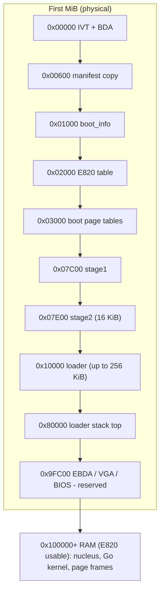
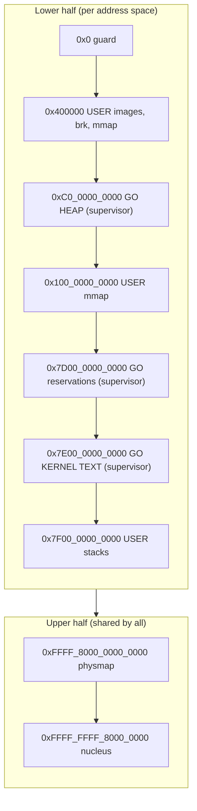

# Memory Map

Two maps matter: the **physical** layout while booting (fixed addresses, chosen by us) and the **virtual** layout once the nucleus runs (chosen by us, enforced by page tables). Every fixed address in this file has exactly one definition in code, listed in the "Defined in" column. If you move something, update both.

## 1. Physical memory during boot (Waves 1-3, implemented)

| Range | Size | Contents | Defined in |
|---|---|---|---|
| `0x00000 - 0x004FF` | 1.25 KiB | Real-mode IVT + BIOS data area. **Do not touch.** | BIOS |
| `0x00500 - 0x005FF` | 256 B | A20 test scratch byte at `0x500` | `stage2.asm a20_check` |
| `0x00600 - 0x007FF` | 512 B | Manifest copy (disk LBA 1) | `MANIFEST_ADDR` |
| `0x01000 - 0x0107F` | 128 B | `struct boot_info` | `BOOTINFO_ADDR` |
| `0x01100 - 0x012FF` | 512 B | `struct boot_module[16]` (boot_info v2, W4) | `BOOT_MODULES_PHYS_ADDR` |
| `0x02000 - 0x02BFF` | 3 KiB | E820 table, up to 128 x 24 B | `E820_ADDR` |
| `0x03000 - 0x05FFF` | 12 KiB | Boot page tables: PML4, PDPT, PD (identity 1 GiB) | `PML4_ADDR` etc. |
| `0x06000 - 0x07BFF` | ~7 KiB | Real/protected-mode stack (grows down from `0x7C00`) | `stage1.asm` |
| `0x07C00 - 0x07DFF` | 512 B | stage1 | BIOS convention |
| `0x07E00 - 0x0BDFF` | 16 KiB | stage2 slot | `STAGE2_ADDR` |
| `0x10000 - 0x4FFFF` | 256 KiB max | loader image + .bss | `LOADER_ADDR`, `LOADER_MAX_SECT` |
| `0x50000 - 0x7FFFF` | 192 KiB | loader stack (top `0x80000`) | `LOADER_STACK_TOP` |
| `0x80000 - 0x9FBFF` | ~127 KiB | free (check E820) | — |
| `0x9FC00 - 0xFFFFF` | — | EBDA, VGA memory, option ROMs, BIOS. **Reserved.** | hardware |
| `0x100000 - 0x3FFFFF` | 3 MiB max | nucleus segments (W4) | `nucleus/linker.ld`, `NUCLEUS_PHYS_BASE/LIMIT` in `loader/layout.h` |
| `0x400000 - 0x3FFFFFFF` | — | loader frame allocator: nucleus disk image, page tables (W4); usable E820 only | `PALLOC_*`, `LOADER_IDENTITY_LIMIT` |
| `0x40000000 -` | — | free RAM per E820 (the loader cannot reach it: stage2 maps only 1 GiB) | — |

Rule of thumb from experience: **anything below 1 MiB that you did not put there yourself belongs to the firmware.** Always consult the E820 map rather than assuming a hole is free.

## 2. Virtual memory once the nucleus runs (Waves 4-9) *(provisional)*

x86-64 has a 48-bit canonical address space: a lower half `0x0000_0000_0000_0000 - 0x0000_7FFF_FFFF_FFFF` and an upper half `0xFFFF_8000_0000_0000 - 0xFFFF_FFFF_FFFF_FFFF`. Everything in between is non-canonical and faults.

| Range | Owner | Contents | Page flags |
|---|---|---|---|
| `0x0000_0000_0000_0000 - 0x0000_0000_003F_FFFF` | — | unmapped guard: catches NULL derefs | none |
| `0x0000_0000_0040_0000 - 0x0000_00BF_FFFF_FFFF` | user | static ELF images (`0x400000`), brk heap, mmap | U |
| `0x0000_00C0_0000_0000 - 0x0000_00FF_FFFF_FFFF` | Go kernel | Go heap arenas (Go <= 1.22 hint `0xc000000000`; Go 1.27 picks a random lower-half hint, which any free range satisfies) | S |
| `0x0000_0100_0000_0000 - 0x0000_7CFF_FFFF_FFFF` | user | more mmap space | U |
| `0x0000_7D00_0000_0000 - 0x0000_7DFF_FFFF_FFFF` | Go kernel | runtime `PROT_NONE` reservations, thread stacks | S |
| `0x0000_7E00_0000_0000 - 0x0000_7EFF_FFFF_FFFF` | Go kernel | Go kernel image (`-ldflags -T 0x7e0000000000`) | S |
| `0x0000_7F00_0000_0000 - 0x0000_7FFF_FFFF_FFFF` | user | user stacks (top-down) | U |
| `0xFFFF_8000_0000_0000 - +RAM size` | nucleus | **physmap**: all physical RAM mapped linearly (below 4 GiB up to the top of RAM; above 4 GiB only the usable ranges, so the PCI hole is never mapped as RAM, W14-S01) | S, NX |
| `0xFFFF_FFFF_8000_0000 - ...` | nucleus | nucleus image (`-mcmodel=kernel`, loaded at phys 1 MiB) | S |
| `0xFFFF_FFFF_C000_0000 - +64 × 20 KiB` | nucleus | kernel stacks: slot i = 4 KiB unmapped guard + 16 KiB stack (`KSTACK_REGION`, `nucleus/sched.c`) | S, NX |

Since W5 the nucleus drops the loader's identity map (PML4[0]) in `vmm_init`, so nothing is mapped below `0x0000_8000_0000_0000` until the Go kernel (W6) reserves it. Device registers are mapped uncached at `physmap_base + phys` (`vm_map_mmio`, e.g. the LAPIC at `0xFEE00000`); since W8 the Go kernel asks for its own with `nu_mmio_map`, e.g. the BGA framebuffer (PCI BAR0, `0xFD000000` on QEMU, 3 MiB at 1024x768x32) at `physmap_base + 0xFD000000`. Go reads boot modules (initrd, the module table) through the physmap too (`amd64.PhysBytes`). Hint-less `vm_reserve` calls are placed from `0x7D00_0000_0000` up (`VM_SEARCH_BASE`); a free hint is honoured. As built in W6 (Go 1.27.3): the Go kernel's segments at `0x7dff_ffff_f000` (R X), `0x7e00_000a_f000` (R), `0x7e00_0018_d000` (RW + bss); its 1 MiB m0 stack and the runtime's hint-less maps from `0x7D00_0000_0000`; the heap at a random hint such as `0x19f9_xxxx_xxxx`.

**As built in W9:** every process has **its own lower half** (its own PML4; the upper half is the kernel's, shared), so the user and Go kernel rows above describe two different address spaces, not one: the Go kernel's lower half lives only in the kernel PML4, and Go never runs on a process's CR3. A process's layout (policy in `kernel/proc`): the ELF at its link address (`0x400000` for static-PIE), the `brk` heap right after the highest segment, anonymous `mmap` from `0x1000_0000_0000` up with a guard page between mappings, and a 256 KiB stack ending at `0x7FFF_FFFF_0000`, all mapped user-accessible. **Since W12** `mmap` and `brk` memory is demand-zero (`kernel/proc/area.go`): they record an area, and a page gets its frame at first touch, a ring-3 page fault Go answers by mapping it (the thread resumes) or a kernel copy in or out. A reservation therefore costs nothing (the Go runtime reserves hundreds of MiB), and a `PROT_NONE` area is genuinely inaccessible. **Since W14** an area may have a backing file (`mmap` of a regular file): its pages fill from the file's `io.ReaderAt` instead of with zeros, and are private copies from then on.

**Since W18** a frame may belong to more than one process, and user memory has four kinds of page (`kernel/proc`, [WAVE-18](../04-plan/waves/WAVE-18-foundations.md)):

| Page | Whose frame | Mapped as | Fork | Freed |
|---|---|---|---|---|
| private (anonymous, `brk`, a private file mapping, a program's segment) | the process's, counted in its family's `frameRefs` (`cow.go`) | its protection; read-only while shared | shared copy-on-write: read-only in both until one writes, which copies it (or, for the last owner, makes it writable again) | when its last owner unmaps it or exits |
| shared (`MAP_SHARED`: anonymous, a `/dev/shm` file, a memfd, a SysV segment) | the shared object's (`shm.go`) | its protection, never copy-on-write | shared as it is | when the object has no handle, no name and no mapped page |
| device (`/dev/fb0`) | the device's | its protection | shared as it is | never |
| reserved (an area with no page yet) | none | not mapped: the first touch faults | the area is copied | - |

A write that breaks a share can come from the program (a ring-3 write fault on a present, read-only page, which the dispatcher sends to `FaultIn`) or from the kernel (`CopyOut`, the ELF loader, `MADV_DONTNEED`'s clearing). A program's file is mapped lazily (`execve`): its whole pages fill from the file at first touch, 64 KiB at a time, its edge pages and bss at once. A dynamic program's interpreter is loaded at `0x7F00_0000_0000`. SysV attachments are kept per address space, so fork inherits them and exit and `execve` detach them. Fork write-protects the parent's pages in runs and maps the child's in batches (`nu_as_protect`, `nu_as_map_batch`).

S = supervisor-only, U = user accessible. The Go kernel and nucleus regions are present in **every** address space but marked supervisor-only, so a user process cannot read them, and its SYSCALL return RIP can never point into Go kernel text (this is what makes the gate's caller check sound, [ADR-0004](../03-decisions/ADR-0004-syscall-gate.md)).

### What is already validated

A host experiment on Go 1.22 (see [census](../01-research/GO_RUNTIME_SYSCALL_CENSUS.md)) showed that the Go linker accepts `-T 0x7e0000000000` and the resulting static binary runs, and that the runtime first tries the heap hint `0xc000000000`. Slice **W6-S01 (spike)** repeats this with the pinned Go version and confirms the runtime tolerates the nucleus returning its own addresses for hint-less `PROT_NONE` reservations.

### Fallback if the spike fails

Keep the Go kernel at the default `0x400000` and build all user programs as **static-PIE** (musl supports it), loading them at a randomised base inside the user ranges. Document the outcome in ADR-0004.

## 3. Page-table ownership

The **nucleus** owns the page-table *mechanism* (walk, map, unmap, TLB flush) and the physmap. The **Go kernel** owns *policy* for user address spaces (which ranges exist, copy-on-write, mmap of files) and asks the nucleus to apply it through `nu_*` calls ([NUCLEUS_ABI.md](NUCLEUS_ABI.md)). The Go kernel reads and writes user memory through the physmap after translating addresses, never by switching CR3.
