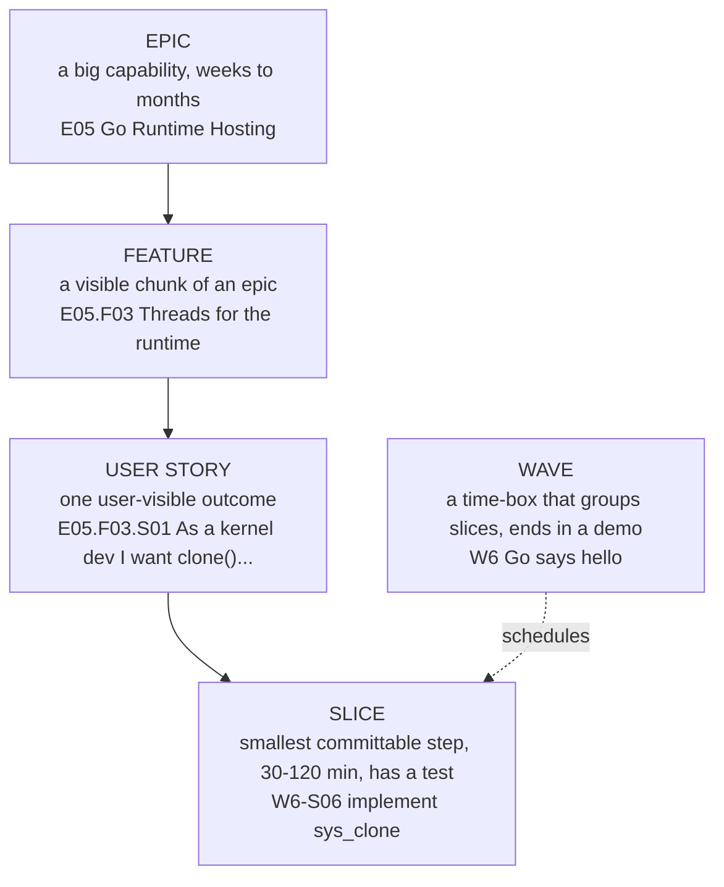

# How the Plan Works

## 1. Vocabulary



| Level | ID format | Size | Owns |
|---|---|---|---|
| Epic | `E05` | many waves | goal, scope, exit criteria |
| Feature | `E05.F03` | 1-3 waves | a coherent set of stories |
| User story | `E05.F03.S01` | 1-5 slices | "As a ... I want ... so that ...", acceptance criteria |
| Slice | `W6-S06` | 30-120 minutes, < ~150 changed lines | exact files, steps, test, marker |
| Wave | `W6` | ends at a milestone demo | ordered slices, exit checklist |

Epics describe **what**; waves describe **when**. A wave can pull slices from several epics (testing and docs slices appear in every wave).

## 2. Rolling-wave detail

Waves 0-6 were planned to slice level up front. Waves 7-12 were planned to story level ([WAVES-07-12.md](waves/WAVES-07-12.md)) and sliced when the previous wave closed, because what W5/W6 taught (especially the Go runtime spike) changed them; it did. Later waves (W13 on) are sliced when they are planned, one or two ahead of the work. This is deliberate, not unfinished.

## 3. Slice template

Every slice in `waves/` follows this shape:

```text
### W2-S03 Detect memory with E820          (story E02.F02.S01)
Goal:     one sentence.
Files:    boot/stage2.asm (+ boot_abi.inc)
Steps:    numbered, small enough to type by hand.
Test:     how you know it works (marker, unit test, gdb check).
Done when: the Definition of Done below holds.
Learn:    the one concept this slice teaches + a link.
```

## 4. Definition of Ready (before starting a slice)

- The slice's story and acceptance criteria are written.
- Any contract it touches (boot_info, manifest, ABI tables) is documented first.
- The test you will use is known (new marker? new unit test? regression case?).

## 5. Definition of Done (before committing)

1. `make test` passes (unit + smoke + regression).
2. New behaviour has a test: unit test for pure logic, marker for boot behaviour, regression case for a fixed bug.
3. `make sizes` still within budget (stage1 < 446 B, stage2 < 16 KiB, loader < 256 KiB).
4. Docs touched: contract docs if a format changed; ADR if a decision changed.
5. A DEVLOG line (one per slice is fine; one entry per session is the minimum).
6. Any bug found gets a `BUG-NNNN` entry, even if fixed in five minutes.
7. One commit, message `W2-S03: detect memory with E820`.

## 6. Status markers used in the plan

`[x]` done and tested · `[~]` in progress · `[ ]` not started · `[spike]` investigation whose output is a decision, not code.
