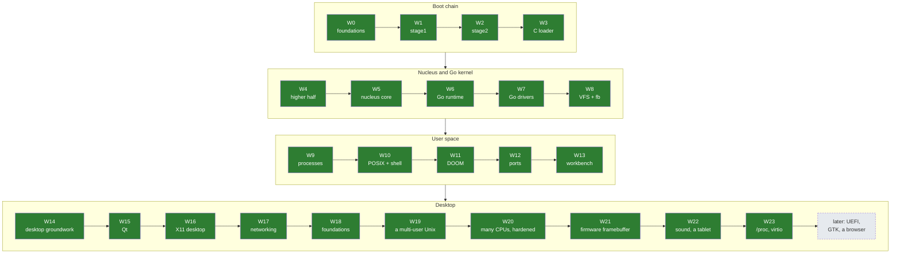

# Roadmap

## Milestones

| M | Name | Demo you can show someone | Wave |
|---|---|---|---|
| M0 | Foundations | `make test` green on an empty-ish repo | W0 |
| M1 | It boots | text from our own boot sector on serial + screen | W1 |
| M2 | Long mode | stage2 reaches 64-bit and calls C | W2 |
| M3 | C loader | `BURROW:LOADER:OK` with every input verified | W3 |
| M4 | Higher half | nucleus runs at `0xFFFFFFFF80100000` with the physmap | W4 |
| M5 | Nucleus alive | exceptions dump registers; two kernel threads ping-pong via futex | W5 |
| M6 | **Go says hello** | stock Go binary prints from ring 0; goroutines + GC stress pass | W6 |
| M7 | Go drives hardware | typing on the keyboard echoes through a Go driver | W7 |
| M8 | Files + pixels | `cat /etc/motd` from initrd; Go draws on the framebuffer | W8 |
| M9 | First process | static musl `hello` runs in ring 3 | W9 |
| M10 | A Unix | busybox shell, pipes, fork/exec | W10 |
| M11 | **DOOM** | Freedoom E1M1 playable in QEMU (done: `make doom-smoke`) | W11 |
| M12 | Ports | Lua REPL, C++ hello with exceptions, Go user program | W12 |
| M13 | A workbench | edit, save and build code inside Burrow; files survive a reboot | W13 |
| M14 | Desktop groundwork | a mouse-driven paint program whose colour arrives over a Unix socket (done: `make desk-smoke`) | W14 |
| M15 | Qt | a Qt text editor on `/dev/fb0` edits and saves a file in `/home` (done: `make qt-smoke`) | W15 |
| M16 | A desktop | `startx`: dwm tiles st terminals, dmenu starts Doom in a window (done: `make x11-smoke`, `make run-desktop`) | W16 |
| M17 | On the network | busybox `wget` from the host, a Go program fetching an HTTPS page, `httpd` inside Burrow reached from the host (done: `make net-smoke`, `make run-net`) | W17 |
| M18 | Bigger programs | Doom in X through MIT-SHM at three quarters of its fbdev rate, a 64 MiB process forks in milliseconds, a dynamic program and `dlopen` (done: `make mem-bench`, `make x11-bench`, `make ports-smoke`) | W18 |
| M19 | A multi-user Unix | boot an ext2 root disk to `login:`, a user denied `/etc/passwd`, `su` with a password, `adduser`, a symbolic link; all still there after a reboot, `e2fsck` clean (done: `make unix-smoke`, `make run-unix`) | W19 |
| M20 | Many CPUs, hardened | four CPUs online, `nproc` 4, a four-thread program at least 2.5 times faster, `GOMAXPROCS=4`, SMEP and SMAP on, ACPI poweroff, `make test` green on four CPUs (done: `make smp-bench`, 3.8x for C and 4.0x for Go; `make test` with `SMP=4` and `SMP=1`) | W20 |
| M21 | A firmware framebuffer | stage2 sets a VBE mode; the console, `/dev/fb0` programs, Doom and X draw at 1280x1024 with a padded pitch from boot_info; the framebuffer is write-combining; DISPI still serves images that ask for no mode (done: `make fb-smoke`, `make vbe-smoke`) | W21 |
| M22 | Sound and an absolute pointer | Doom's sound effects through AC'97, recorded and checked; `tone`'s 440 Hz measured; the pointer in X, Qt and paint where the host's is, with no grab (done: `make sound-smoke`, `make tablet-smoke`, `desktop-smoke` with both) | W22 |
| M23 | /proc and virtio devices | busybox `ps`, `top`, `free`, `tty`, `df` and `mount` work and `top` sees CPU time; the root and home disks on virtio-blk, the network on virtio-net with DHCP; `logger` reaches `syslogd` (done: `make proc-smoke`, `make virtio-smoke`) | W23 |

Green = done, yellow = next, grey = planned.

## Critical path and risk

The critical path was **W5 -> W6**: Go could not run until the nucleus had threads, futexes and a reserve/commit VM, and W6 held the riskiest spike (ADR-0003); both are done. Everything since has been "normal" OS work with many reference implementations. W14 laid the desktop groundwork (more RAM, a mouse, the start-up calls, a clock, file mappings, Unix sockets with descriptor passing, the console's graphics modes); W15 put Qt widget programs on `/dev/fb0`; W16 an X11 desktop with dwm. W17 put it on the network: an e1000 driver, gVisor's TCP/IP stack in the kernel, `AF_INET` sockets, names, servers inside Burrow and HTTPS from a Go program. W18 laid the foundations bigger programs want: copy-on-write fork, lazy `execve`, shared memory with MIT-SHM, dynamic linking. W19 made it a multi-user Unix: ext2 read and written, users and groups, permissions, links, and an ext2 root disk that boots to `login:`. W20 hardened it and put it on every CPU: SMEP, SMAP, XSAVE and ACPI, application processors behind per-CPU GS, one run queue, TLB shootdown, and the Go kernel with a P per CPU. W21 (E02.F04, E07.F04) took the framebuffer from the firmware: VBE in stage2, a boot_info descriptor, any geometry and pixel format, write-combining, the bring-up step real hardware needs that QEMU's DISPI device let us skip. W22 (E18.F05-F07) added sound (AC'97, OSS's `/dev/dsp`, Doom's effects) and an absolute pointer (virtio-input over a virtio transport that block and network devices can use later), on shared interrupt lines. W23 (E20) gave Burrow `/proc` and CPU time, so the tools that look inside a Unix work, and virtio-blk, virtio-net and DHCP on W22's transport, now the run targets' default. Next: UEFI and GOP, towards real hardware. See [RISKS.md](../living/RISKS.md).

## Rough effort (part-time, one person)

| Waves | Estimate | Note |
|---|---|---|
| W0-W3 | done | re-typing them for learning: 1-2 weekends |
| W4-W5 | 3-5 weekends | lots of new concepts; budget debugging time |
| W6 | 2-6 weekends | widest uncertainty |
| W7-W8 | 3-4 weekends | |
| W9-W10 | 5-8 weekends | processes are the second big hump |
| W11 | 1-3 weekends | mostly fbdev/evdev/mmap glue if W10 is solid |
| W12 | open-ended | |
