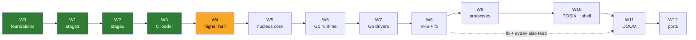

# Roadmap

## Milestones

| M | Name | Demo you can show someone | Wave |
|---|---|---|---|
| M0 | Foundations | `make test` green on an empty-ish repo | W0 |
| M1 | It boots | text from our own boot sector on serial + screen | W1 |
| M2 | Long mode | stage2 reaches 64-bit and calls C | W2 |
| M3 | C loader | `BURROW:LOADER:OK` with every input verified | W3 |
| M4 | Higher half | nucleus runs at `0xFFFFFFFF80100000` with the physmap | W4 |
| M5 | Nucleus alive | exceptions dump registers; two kernel threads ping-pong via futex | W5 |
| M6 | **Go says hello** | stock Go binary prints from ring 0; goroutines + GC stress pass | W6 |
| M7 | Go drives hardware | typing on the keyboard echoes through a Go driver | W7 |
| M8 | Files + pixels | `cat /etc/motd` from initrd; Go draws on the framebuffer | W8 |
| M9 | First process | static musl `hello` runs in ring 3 | W9 |
| M10 | A Unix | busybox shell, pipes, fork/exec | W10 |
| M11 | **DOOM** | Freedoom E1M1 playable in QEMU | W11 |
| M12 | Ports | Lua REPL, C++ hello with exceptions, Go user program | W12 |

Green = done in the starter kit, yellow = next.

## Critical path and risk

The critical path is **W5 -> W6**: Go cannot run until the nucleus has threads, futexes and a reserve/commit VM, and W6 contains the riskiest spike (ADR-0003). Everything after W6 is "normal" OS work with many reference implementations. Plan accordingly: do not polish W4 visuals while W6 is unproven. See [RISKS.md](../living/RISKS.md).

## Rough effort (part-time, one person)

| Waves | Estimate | Note |
|---|---|---|
| W0-W3 | done | re-typing them for learning: 1-2 weekends |
| W4-W5 | 3-5 weekends | lots of new concepts; budget debugging time |
| W6 | 2-6 weekends | widest uncertainty |
| W7-W8 | 3-4 weekends | |
| W9-W10 | 5-8 weekends | processes are the second big hump |
| W11 | 1-3 weekends | mostly fbdev/evdev/mmap glue if W10 is solid |
| W12 | open-ended | |
