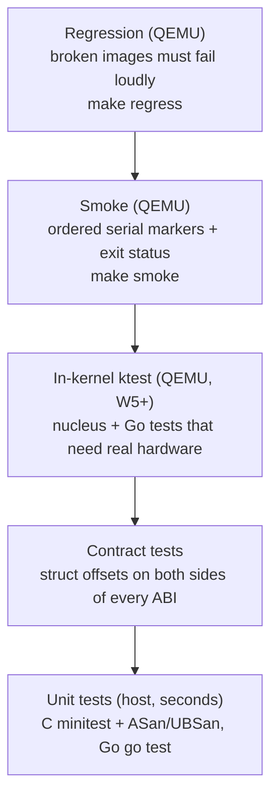

# Test Strategy

Decision: [ADR-0007](../03-decisions/ADR-0007-test-strategy.md). Principle: **most kernel logic should never need a VM to be tested.**

## 1. The pyramid



| Kind | Command | Runs where | Speed | Example |
|---|---|---|---|---|
| Unit (C) | `make test-c` | host gcc, ASan+UBSan | <1 s | `test_elf64.c` |
| Unit (Go) | `make test-go` | host `go test` | ~1 s | UART init sequence via `FakePorts` |
| Contract | inside unit tests + `_Static_assert` | both | — | `TestManifestLayoutMatchesC` |
| Smoke | `make smoke` | QEMU headless | ~0.5 s | `boot_to_loader.txt`, `boot_to_nucleus.txt` |
| Regression | `make regress` | QEMU, mutated images | ~0.5 s | REG-0001 corrupt loader |
| ktest (W5+) | `make ktest` | QEMU, one image per suite | ~0.5 s per suite | `tests/ktest/trap.txt` |
| Census (W6+) | `make census` | host strace | seconds | Go upgrade adds a syscall |
| Docs | `make docs-check` | node + mermaid | seconds | all diagrams parse |

`make test` = unit + smoke + ktest + regress (census joins in W6).

## 2. Rules

1. **Pure core, thin shell.** If a function can take bytes and return a result, it goes in its own file with no `io.h` include, and gets host tests.
2. **Every interface gets a fake.** C: a struct of function pointers (`char_sink`, `block_device`). Go: an interface in `hal` + a fake in `haltest`.
3. **Every bug gets a test** named after it (`REG-NNNN` or a unit test referencing `BUG-NNNN`) unless genuinely untestable; then BUGS says why.
4. **Markers are append-only.** Never weaken an expect file to make a test pass.
5. **Two implementations agreeing is evidence.** ELF tests build images with the host `<elf.h>`; ATA output is compared with BIOS output; mkimage CRC equals stage2 asm CRC equals loader C CRC.
6. **Fail fast and loud.** All failure paths write debug-exit `0x11`, so a failing test finishes in milliseconds, not at a timeout.

## 3. Serial-marker protocol

- Format: `[component] message`; success line `BURROW:<NAME>:OK`.
- `tests/smoke/smoke.sh  <expect-file>` asserts every expect line appears **in order**, no line contains `PANIC` or `FAIL`, and QEMU exits with 33.
- Logs land in `build/smoke-<name>.log`; attach them to bug entries.

## 4. QEMU exit codes

| Guest writes to 0xF4 | QEMU process exit status | Meaning |
|---|---|---|
| 0x10 | 33 | pass |
| 0x11 | 35 | fail (any stage) |
| (nothing, timeout) | 124 | hang = bug; investigate with `make debug` |

## 5. Adding a test: checklists

**New pure C module:** create `tests/unit/c/test_<mod>.c`, add the `.c` to `UNIT_SRC` in the Makefile, declare and `RUN()` each test in `test_main.c`.
**New boot stage marker:** add the print, append the line to the expect file, run `make smoke`.
**New regression case:** write a mutator function in `tests/regression/run_all.sh`, add `case_run REG-NNNN-name "<expected text>" 35 mutator`, link it from the BUG entry.
**New ktest (in-kernel test):** write `int kt_<name>(void)` using `KT_CHECK` in a `nucleus/ktest_*.c`, declare it in `nucleus/ktest.h`, add it to the table in `nucleus/ktest.c`, list it in a suite `tests/ktest/<suite>.txt` and append `[ktest] <name> ok` to `tests/ktest/expect/<suite>.txt`. `make ktest` builds `build/ktest-<suite>.img` (the normal image plus a `ktest` payload) and runs the smoke checker on it. A test that must crash goes in the regression suite instead (`with_ktest <name>` in `run_all.sh`, e.g. REG-0005).
**New Go package:** `_test.go` next to it; use `haltest` fakes; run `make test-go`.

## 6. Diagram checking

`tools/doccheck/` contains a Node script that parses every Mermaid block with the official parser:

```sh
cd tools/doccheck && npm install && node check.mjs $(git ls-files '*.md' | sed 's#^#../../#')
```
