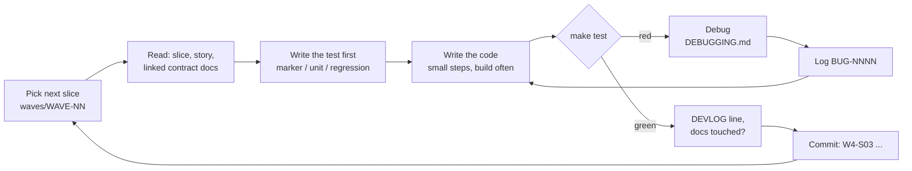

# Working a Slice (manual, no AI required)

## A session, step by step

1. `git pull && make clean test` — start from green.
2. Open the wave file; mark the slice `[~]`.
3. Re-read any contract the slice touches (BOOT_PROTOCOL, MEMORY_MAP, ABI).
4. Write the test or marker first; run it and **see it fail**.
5. Implement in the smallest steps you can build. Run `make` after each.
6. `make test`. Red? Use the debugging guide. Every surprise → BUGS entry.
7. Update docs and the DEVLOG; mark the slice `[x]`.
8. Commit with the slice ID.

## Using an assistant (Claude Code, Codex, ...) safely
Optional. Give it exactly one slice file plus the contract docs it touches; ask for code *and* the test; run `make test` yourself; read every line before committing. The plan is written so a human can do every step without one.
